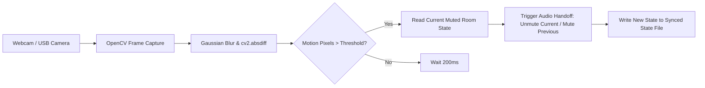

# Vision Room Presence Mute (OpenCV + Smart Home Audio Handoff)

A computer vision presence detection system that automates smart TV / media device audio handoff between rooms based on camera motion differentials.

---

## 👁️ How It Works

1. **Computer Vision Presence Pipeline**: Reads frames from a webcam or USB camera, applies Gaussian blur smoothing, and computes absolute pixel intensity differentials (`cv2.absdiff`) between consecutive frames.
2. **Motion Burst Detection**: When moving pixels cross a configured threshold (`--threshold`), the system detects presence and triggers an audio handoff.
3. **Multi-Room Coordination**: Syncs state across nodes using a synchronized state file (`room_muted_state.txt`) so when you walk into the bedroom, the living room TV is muted and bedroom audio is unmuted.
4. **Hardware Device Control**: Communicates with Roku TVs and smart receivers using Roku ECP (External Control Protocol).



---

## 🛠️ Setup

### Prerequisites
- Python 3.10+
- Webcam or USB camera device
- OpenCV (`pip install -r requirements.txt`)

---

## 🚀 Usage

### Dual-Room State Coordinator
Run on the device stationed in the living room:
```bash
python3 room_checker_dual.py --present-in livingroom --state-file room_muted_state.txt
```

Run on the device stationed in the bedroom:
```bash
python3 room_checker_dual.py --present-in bedroom --state-file room_muted_state.txt
```

### Standalone Single-Room Motion Timeout
Monitors a room and automatically mutes the TV if no motion is seen for a timeout duration:
```bash
python3 room_checker.py
```

### CLI Parameters

| Flag | Default | Description |
| :--- | :--- | :--- |
| `--present-in` | *Required* | Current room location (`livingroom` or `bedroom`) |
| `--threshold` | `5000` | Minimum motion pixel intensity sum to register presence |
| `--camera` | `0` | OpenCV camera index (`/dev/video0`) |
| `--state-file` | `room_muted_state.txt` | Path to shared room mute state file |
| `--init-muted` | None | Initial room state on cold start |

---

## 📄 License

MIT
